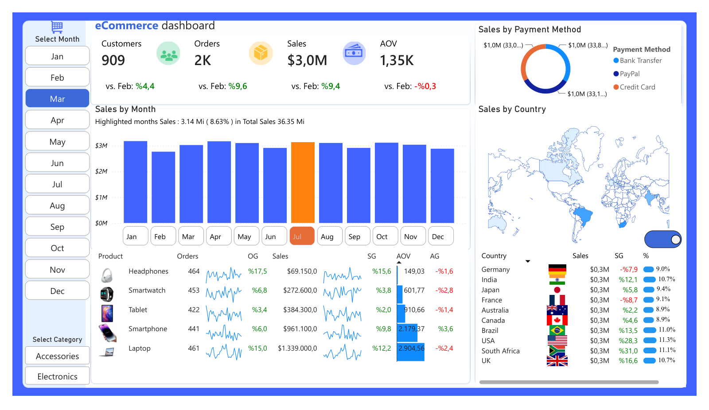

# Training E-Commerce Dashboard

[← Ana sayfa](../README.md)

Bu proje, Power BI eğitiminde çalıştığım e-ticaret dashboard yapısını videoya bakmadan tekrar kurarak geliştirdiğim bir çalışmadır.

Amaç; KPI kartlarını, dilimleyici kullanımını, DAX ölçülerini, grafik düzenini ve dashboard tasarım mantığını kendi başıma tekrar uygulayabilmekti.

## Dashboard Önizleme

Dashboard PDF olarak görüntülenebilir. Power BI dosyası PBIT (şablon) formatında indirilebilir.

- [Dashboard PDF dosyasını görüntüle](dashboard.pdf)
- [Power BI PBIT şablonunu indir](dashboard.pbit)

## Öne Çıkan Bulgular

Önizlemedeki görünümde Mart ayı ve tüm kategoriler seçilidir.

- Yıllık toplam satış 36,35M; aylık satışlar yaklaşık 2,7M ile 3,2M arasında dengeli seyrediyor.
- Mart ayında satış bir önceki aya göre %9,4 artmış, AOV ise %0,3 düşmüştür.
- Üç ödeme yöntemi (Bank Transfer, PayPal, Credit Card) satışları neredeyse eşit (~%33) paylaşıyor.
- Laptop, sipariş adedi diğer ürünlere yakın olmasına rağmen en yüksek satış tutarını ve AOV'yi üretiyor.

## Dashboard İçeriği

- Customers
- Orders
- Sales
- AOV
- Sales by Month
- Sales by Payment Method
- Product Table
- Sales by Country
- Month Slicer
- Category Slicer

## Uygulanan Konular

- KPI kartları
- DAX ölçüleri
- Önceki ay karşılaştırması
- Büyüme oranı ölçüleri
- Koşullu biçimlendirme
- Ay dilimleyici
- Kategori dilimleyici / filtre
- Donut grafiği
- Sütun grafiği
- Dinamik ay vurgulama
- AOV hesaplama
- Ödeme türü analizi
- Aylık satış analizi
- Ülke / kıta bazlı satış analizi

## Kullanılan DAX Ölçüleri

Bu dashboard'da KPI kartları, önceki ay karşılaştırmaları, büyüme oranları ve koşullu renk formatları için DAX ölçüleri kullanılmıştır.

[DAX ölçülerini görüntüle](dax/DAX_Measures.md)

## Veri ve Veri Modeli

- **Veri:** Eğitim kapsamında verilen `ecommerce_data.csv` dosyası (sipariş, ürün, ülke ve ödeme bilgileri). Veri dosyası bu depoda yer almaz.
- **Model:** `facteCommerce` olgu tablosu; ürün, ülke, ödeme yöntemi ve ödeme durumu boyut tabloları; ayrıca DAX ile oluşturulan `Calendar` tarih tablosu.
- **PBIT dosyasını açma:** Şablon açılırken veri yolu bulunamazsa Power Query'de kaynak yolunu kendi `ecommerce_data.csv` dosyanızın konumuyla değiştirin.

## Proje Amacı

Bu çalışmanın amacı, eğitimde öğrenilen Power BI dashboard yapısını videoya bakmadan tekrar kurarak pratik becerimi geliştirmektir.
