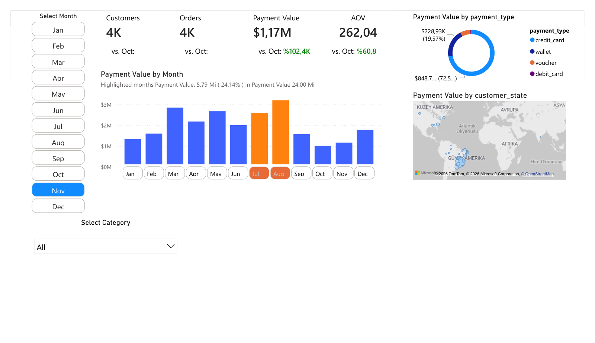

# Brazil Olist E-Commerce Dashboard

[← Ana sayfa](../README.md)

Bu proje, Olist Brazil E-Commerce veri seti üzerinde geliştirdiğim Power BI dashboard çalışmasıdır.

Dashboard'da müşteri, sipariş, ödeme tutarı, ortalama sipariş değeri, ödeme tipi, kategori ve eyalet bazlı dağılım analiz edilmiştir.

## Dashboard Önizleme

Dashboard PDF olarak görüntülenebilir. Power BI dosyası PBIT (şablon) formatında indirilebilir.

- [Dashboard PDF dosyasını görüntüle](dashboard.pdf)
- [Power BI PBIT şablonunu indir](dashboard.pbit)

## Veri Kaynağı

[Brazilian E-Commerce Public Dataset by Olist (Kaggle)](https://www.kaggle.com/datasets/olistbr/brazilian-ecommerce)

Aynı verinin SQL ile analizi ve veri kalite kontrolleri: [E-Commerce Business SQL Analysis](../Ecommerce_Business_SQL_Analysis/README.md)

## Öne Çıkan Bulgular

Önizlemedeki görünümde Kasım ayı ve tüm kategoriler seçilidir.

- Grafikteki ayların toplam ödeme tutarı 24,00M; en yüksek ay Ağustos.
- Temmuz ve Ağustos birlikte toplam ödeme tutarının %24,14'ünü oluşturuyor (5,79M).
- Kasım ayında ödeme tutarı Ekim'e göre %102,4, AOV ise %60,8 artmış.
- Ödeme tutarının büyük kısmı (~%72,5) kredi kartı ile yapılmış.

## Dashboard İçeriği

- Customers
- Orders
- Payment Value
- AOV
- Payment Value by Month
- Payment Value by Payment Type
- Payment Value by Customer State
- Category Filter
- Month Slicer

## Uygulanan Konular

- KPI kartları
- DAX ölçüleri
- Önceki ay karşılaştırması
- Büyüme oranı ölçüleri
- Koşullu biçimlendirme
- Ay dilimleyici
- Kategori dilimleyici / filtresi
- Donut grafiği
- Sütun grafiği
- Harita görseli
- Dinamik ay vurgulama
- AOV hesaplama
- Ödeme türü analizi
- Aylık ödeme analizi

## Kullanılan DAX Ölçüleri

Bu dashboard'da KPI kartları, önceki ay karşılaştırmaları, büyüme oranları ve koşullu renk formatları için DAX ölçüleri kullanılmıştır.

[DAX ölçülerini görüntüle](dax/DAX_Measures.md)

## Veri ve Veri Modeli

- **Veri:** Olist CSV dosyaları SQL Server'daki `E_commerce` veritabanına `df_` tabloları olarak aktarıldı. Aynı tablolar [E-Commerce Business SQL Analysis](../Ecommerce_Business_SQL_Analysis/README.md) projesinde de kullanılıyor; tabloların nasıl yükleneceği o sayfada anlatılıyor.
- **Model:** `df_Orders`, `df_OrderItems`, `df_Payments`, `df_Customers` ve `df_Products` tabloları; ürün, ödeme tipi ve eyalet boyut tabloları; ayrıca DAX ile oluşturulan `Calendar` tarih tablosu.
- **PBIT dosyasını açma:** Şablon, verileri yerel `.\SQLEXPRESS` sunucusundaki `E_commerce` veritabanından okur. Sunucu adı farklıysa açılışta kendi SQL Server adınızı girin.

## Proje Amacı

Bu projenin amacı, e-ticaret verisi üzerinden temel iş metriklerini analiz etmek ve bu metrikleri Power BI dashboard üzerinde anlaşılır şekilde sunmaktır.
