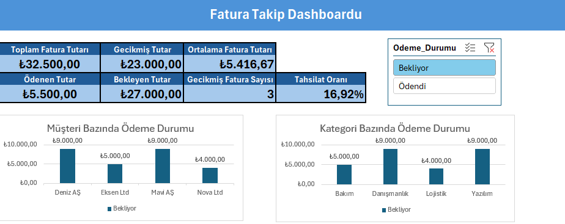

# Excel Invoice Tracking Dashboard

[← Ana sayfa](../README.md)

## Proje Hakkında

Bu projede Excel kullanılarak faturaların ödeme ve vade durumlarını takip eden interaktif bir dashboard hazırlanmıştır.

Amaç; toplam, ödenen, bekleyen ve vadesi geçmiş fatura tutarlarını tek ekranda göstermek ve tahsilat takibini kolaylaştırmaktır.

## Dashboard Görünümü

## Çalışma Kitabının Yapısı

| Sayfa | İçerik |
| --- | --- |
| Dashboard | KPI kartları, müşteri ve kategori bazında ödeme durumu grafikleri, ödeme durumu slicer'ı |
| `Fatura_Takip` | Fatura listesi (Excel tablosu): fatura no, tarih, müşteri, kategori, adet, birim fiyat, toplam tutar, son ödeme tarihi, ödeme durumu, şehir ve takip durumu |
| `Müşteri_Bilgileri` | Müşteri, şehir ve vade günü bilgileri |
| `Pivot_Musteri`, `Pivot_Kategori` | Grafiklerin kaynağı olan PivotTable'lar |

## KPI'lar ve Hesaplama Mantığı

| KPI | Hesaplama |
| --- | --- |
| Toplam Fatura Tutarı | `SUM` ile tüm faturaların toplamı |
| Ödenen / Bekleyen Tutar | `SUMIF` ile ödeme durumu "Ödendi" / "Bekliyor" olan faturaların toplamı |
| Gecikmiş Tutar | `SUMIFS` ile son ödeme tarihi bugünden (`TODAY`) önce olan ve hâlâ bekleyen faturaların toplamı |
| Gecikmiş Fatura Sayısı | `COUNTIFS` ile aynı koşuldaki fatura sayısı |
| Ortalama Fatura Tutarı | `AVERAGE` ile fatura başına ortalama tutar |
| Tahsilat Oranı | Ödenen tutarın toplam tutara oranı (`IFERROR` ile sıfıra bölme kontrolü) |

Fatura listesinde ayrıca:

- `VLOOKUP` ile müşterinin şehri `Müşteri_Bilgileri` sayfasından getirilir.
- `IF` ve `TODAY` ile her faturaya **Kapandı / Gecikmiş / Bekliyor** takip durumu verilir.
- Koşullu biçimlendirme ile takip durumu sütunu renklendirilir.

## Kullanılan Özellikler

- PivotTable ve PivotChart
- KPI kartları
- IF, SUMIF, SUMIFS ve COUNTIFS formülleri
- VLOOKUP ile veri eşleştirme
- TODAY ile vade kontrolü
- Koşullu biçimlendirme
- Slicer ile dinamik filtreleme

## Proje Dosyası

[Excel dosyasını indir](Invoice_Tracking_Dashboard.xlsx)

Fatura ve müşteri bilgileri kurgusaldır.
